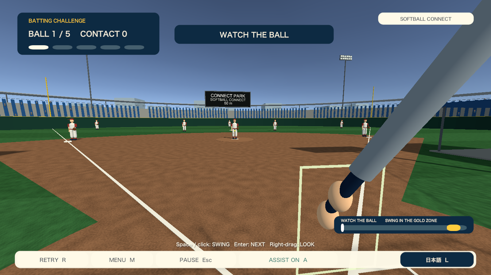

# Softball Connect — PC打撃MVP

開発環境は **Unity 6000.6.8f1** / URP **17.6.0** / Input System **1.20.1** に統一しています。Phase 0〜1を基盤に、PC打撃の打者視点と球場表示を改善しています。守備・走塁・HMD実機対応は後続です。

打者の目線でプレイする、5球の打撃チャレンジです。打球後も視点は打席に留まり、PCでは右ドラッグで見回せます。初期表示は英語、言語ボタンまたはLで日本語へ切り替えられます。芝・土の質感、段床と座席、防球ネット・照明・ダッグアウトを備えた球場を生成します。



Unity Hubからこの`I-project`フォルダを開き、`Assets/_SoftballConnect/Scenes/Bootstrap.unity`でPlay。Enterで開始、Spaceまたは左クリックでスイング、結果を見てEnterで次球へ進みます。5球終了後はEnterで再挑戦できます。

```text
I-project/
├── Assets/          Unityアセット・シーン・C#・Unityテスト
├── Packages/        パッケージ定義とlock
├── ProjectSettings/ Unityバージョン・ビルド・描画等の設定
├── Docs/            仕様・概要・設計・操作・検証記録
├── .github/         共同作業の案内・PR/Issueテンプレート
├── Tools/           構成検査・Unityテスト実行スクリプト
├── TestResults/     検証結果XML・プレビューPNG
├── Reports/         レポート用の画像4枚・キャプション・再撮影手順
├── README.md        起動方法と文書への入口
├── .gitignore       Unity生成物・IDEキャッシュ等の除外
└── .gitattributes   Gitのテキスト・改行設定
```

- [プロジェクト概要](Docs/PROJECT_OVERVIEW.md)
- [GitHubでの共同作業ルール](Docs/CONTRIBUTING.md)
- [開発・Unityアセット編集のルール](Docs/DEVELOPMENT_RULES.md)
- [Editor操作・設定・テスト手順](Docs/EDITOR_GUIDE.md)
- [初期監査と仕様との差分](Docs/PROJECT_AUDIT.md)
- [旧アセットの整理](Docs/LEGACY_CLEANUP.md)
- [レポート用の4枚の画像](Reports/README.md)
- [アーキテクチャとファイルの責務](Docs/ARCHITECTURE.md)
- [打者視点・言語・スタジアムの調整](Docs/FIRST_PERSON_STADIUM.md)
- [以前のアーケード表示の記録](Docs/ARCADE_PRESENTATION.md)
- [実行した検証・未検証項目](Docs/VALIDATION.md)
- [変更ファイル一覧と次フェーズ](Docs/CHANGELOG_PHASE_0_1.md)
- [開発マスター仕様](Docs/SOFTBALL_GAME_MASTER_SPEC.md)

## 共同作業の基本

- 最新の`main`から作業ブランチを作り、目的ごとにIssue・PRを分けます。`main`へ直接pushしません。
- 作成者以外の1名以上がレビューし、必要な確認・指摘の解決後にマージします。
- シーン・Prefab・共通設定は編集前に対象パスと担当をIssueで共有し、同時編集を避けます。
- アセットと`.meta`はセットで管理します。生成された`.csproj`や`Library/`等はコミットしません。
- 実行した検証と未検証項目を分けてPRに記載します。

詳細な作業手順とGitHub管理者向けの保護設定項目は[共同作業ルール](Docs/CONTRIBUTING.md)を参照してください。リモートの保護設定はこの変更では操作していません。

開発文書は`Docs/`、Unityが読み込む実行用コンテンツは`Assets/`に配置します。GitHub用の案内・テンプレートは`.github/`、`.gitignore`と`.gitattributes`はプロジェクト直下に置きます。
